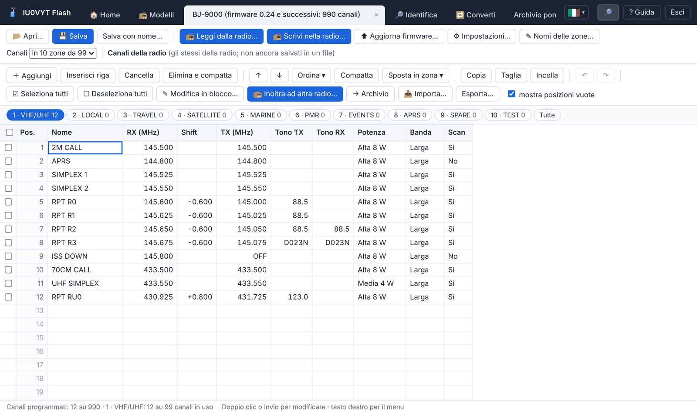
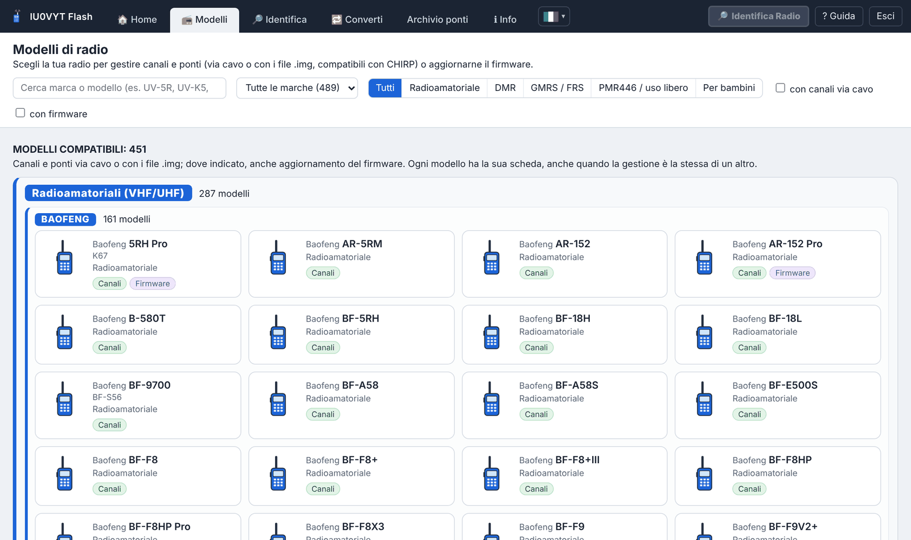

# IU0VYT Flash

<div align="center">
<table>
<tr>
<td align="center"><a href="README.md"><br><sub>English</sub></a></td>
<td align="center"><br><sub><b>Italiano</b></sub></td>
<td align="center"><a href="lingue/fr/README.md"><br><sub>Français</sub></a></td>
<td align="center"><a href="lingue/de/README.md"><br><sub>Deutsch</sub></a></td>
<td align="center"><a href="lingue/es/README.md"><br><sub>Español</sub></a></td>
<td align="center"><a href="lingue/pt/README.md"><br><sub>Português</sub></a></td>
<td align="center"><a href="lingue/ru/README.md"><br><sub>Русский</sub></a></td>
<td align="center"><a href="lingue/zh/README.md"><br><sub>中文</sub></a></td>
<td align="center"><a href="lingue/ja/README.md"><br><sub>日本語</sub></a></td>
<td align="center"><a href="lingue/ko/README.md"><br><sub>한국어</sub></a></td>
<td align="center"><a href="lingue/ar/README.md"><br><sub>العربية</sub></a></td>
<td align="center"><a href="lingue/ms/README.md"><br><sub>Bahasa Melayu</sub></a></td>
<td align="center"><a href="lingue/hi/README.md"><br><sub>हिन्दी</sub></a></td>
</tr>
</table>
</div>

<p align="center">
<a href="https://github.com/IU0VYT/IU0VYT/releases/latest"></a>
<a href="https://github.com/IU0VYT/IU0VYT/releases"></a>
<a href="LICENSE"></a>


</p>

**Versione 4.16.0** · Windows · interfaccia in 13 lingue (italiano, English, Français, Deutsch, Español, Português, Русский, 中文, 日本語, 한국어, العربية, Bahasa Melayu, हिन्दी) · un solo file eseguibile, nessuna installazione

Programma per radioamatori e utenti di ricetrasmettitori di **47 marche** (**Baofeng**, **Bajeton**, **Quansheng**, **Retevis**, **Radtel**, **Radioddity**, **TIDRADIO**, **TYT**, **Hiroyasu**, Talkpod, Anysecu, MaxTalker, Abbree, Intek, Maverick, BTECH, WLN, Zastone, Luiton, TID, Explorer, MMLradio, JJCC, Socotran, Jianpai, Boristone, HamGeek, SenhaiX, Cignus, Puxing, Feidaxin, KYD, KSUN, Lanchonlh, Boblov, Wouxun, AnyTone, QYT, Rugged, Baojie, MTC, Zartek, Ruyage, TDXone, Yaesu, Icom, Kenwood): legge e scrive canali, frequenze e impostazioni via cavo di programmazione, gestisce un archivio dei ponti radio italiani e aggiorna il firmware delle radio supportate.

🌐 Sito del programma: **[iu0vyt.github.io/IU0VYT](https://iu0vyt.github.io/IU0VYT/)**

<p align="center">


</p>

## Funzioni

- **Canali e frequenze** di 485 modelli (comprese radio PMR digitali e DMR, anche via USB): lettura e scrittura via cavo, file `.img` compatibili con CHIRP, file originali del Baofeng K67 Pro (`.xlc`) e della Bajeton 8300 (`.dat`).
- **Impostazioni delle radio** (menu, display, VOX, squelch, TOT, DTMF, tasti…) per 419 modelli, con la descrizione di ogni voce e un avviso da confermare per quelle delicate.
- **Identificazione della radio collegata**: il programma la riconosce da solo e mostra marca, modello, tipo, firmware e le altre informazioni che comunica (per le radio DMR USB anche ID DMR e nome). Con l'**identificazione automatica** (pulsante nella scheda «Identifica», scelta ricordata) basta collegare il cavo, in qualsiasi scheda ci si trovi: il programma ascolta tutte le porte dei cavi insieme, riconosce anche una radio accesa dopo aver collegato il cavo e più radio collegate a cavi diversi, prova per prime le radio già riconosciute in passato e le più diffuse, non si fa ingannare dalle radio in modalità aggiornamento del firmware e apre la scheda di ciascuna con i canali letti; il riquadro «Identificazione Radio In Corso» compare solo per il cavo con una radio che risponde; per un'altra radio c'è il pulsante **«🔎 Identifica Radio»** in alto a destra.
- **Inoltro ad altra radio**: i canali spuntati in una radio vengono scritti direttamente in un'altra radio collegata, scelta per marca e modello, con controllo di compatibilità, adattamento, copia di sicurezza e verifica.
- **Convertitore universale**: i canali di qualsiasi radio o file (K67 `.xlc`, Bajeton `.dat`, immagini `.img` anche di CHIRP, CSV di CHIRP, Excel/CSV) nel formato di qualsiasi altra radio, adattati alle sue regole.
- **Interfaccia in 13 lingue** con il selettore delle bandiere accanto a «ℹ Info»: traduzione immediata di tutto il programma (l'arabo da destra a sinistra), lingua ricordata al riavvio; file informativi tradotti nella cartella `lingue`.
- **Nomi delle zone** al posto di «Zona 1», «Zona 2»… (Radtel RT-950 Pro, RT-950, RT-920, RT-910, Bajeton BJ-9000 e BJ-7700, Hiroyasu HI-UV850 Pro; zone delle radio DMR RD-5R, DM-1801 e DM-32UV), letti e scritti via cavo con i canali.
- **Modifica in blocco** dei canali spuntati: potenza, banda, scansione, subtoni, shift o trasmissione insieme, il resto di ogni canale resta com'è.
- **Galleria di 539 modelli** di 47 marche, divisi tra compatibili e non compatibili, per tipologia (radioamatoriali, DMR, GMRS/FRS, PMR446, per bambini) e per marca, con ricerca, filtri e collegamenti ai programmi e ai manuali ufficiali.
- **Archivio dei ponti radio** basato sull'elenco aggiornato di [IK2ANE](https://www.ik2ane.it), con filtri e inserimento nelle radio, con il controllo della compatibilità tra ponti e radio prima della scrittura.
- **Aggiornamento del firmware** di 57 modelli (anche le Quansheng UV-K5, UV-K6 e UV-5R Plus, le Radtel RT-590 e RT-600 con i file .bin di Quansheng e di Radtel, le Radtel RT-470, RT-470L, RT-470X, RT-495 e RT-630 con i file .kdhx di Radtel, le TIDRADIO TD-H3, TD-H8 e Radtel RT-730 con i file .BIN del costruttore, le Retevis RA79 V3 e RA89 con i file .bin e la Retevis RT85 con i file .hex di Retevis, le Radtel RT-950 Pro e RT-950 e la Bajeton BJ-9000 con i file .BTF, le Radtel RT-920 e RT-910B con i file .anc, le Radtel RT-910 e RT-900 e la Bajeton BJ-7700 senza Bluetooth con i file .BTU, la Radtel RT-890 con i file .bin di Radtel e M7OCM, la Baofeng DM-1701 via USB con i file .bin di Baofeng, le Baofeng RD-5R e DM-1801 via USB con i file .sgl), con controllo del file e copia di sicurezza della radio; aggiornamento guidato con il programma ufficiale per BTECH DMR-6X2 e DMR-6X2 PRO.
- **Copia di sicurezza** automatica prima di ogni scrittura e verifica dopo.
- **Verifica degli aggiornamenti** del programma a ogni avvio.

## Uso

1. Scarica [`IU0VYT.Flash.zip`](https://github.com/IU0VYT/IU0VYT/releases/latest/download/IU0VYT.Flash.zip) (ultima versione) ed estrai l'archivio.
2. Avvia `IU0VYT Flash.exe` (Windows 10/11; usa il componente WebView2 di Windows).
3. Dalla scheda **📻 Modelli** scegli la tua radio, collega il cavo e usa **Leggi dalla radio**.

La guida completa è nel file `LEGGIMI.txt`.

## Compilazione

Serve Go 1.22 o successivo. Nella cartella `sorgenti`:

```
go build -mod=vendor -trimpath -ldflags "-H=windowsgui -s -w" -o "IU0VYT Flash.exe" .
```

Le librerie sono incluse nella cartella `vendor`.

## Avvertenze

- I protocolli delle radio sono stati ricostruiti per l'interoperabilità e verificati con radio simulate: **conserva sempre le copie di sicurezza**. Il programma è fornito senza alcuna garanzia.
- Programma indipendente, **non affiliato né approvato** dai costruttori delle radio (Baofeng, Bajeton, Quansheng, Retevis, Radtel, Radioddity, TIDRADIO e gli altri). I marchi citati appartengono ai rispettivi titolari e servono solo a indicare le radio compatibili.
- Rispetta le norme sull'uso delle frequenze del tuo Paese.

## Ringraziamenti

- [CHIRP](https://chirpmyradio.com) e i suoi autori: gran parte dei driver delle radio deriva dal loro lavoro.
- [IK2ANE](https://www.ik2ane.it), che mette a disposizione di tutti, gratuitamente, l'elenco dei ponti radio italiani.

Autori e licenze dei componenti: `AUTORI_E_LICENZE.txt`.

## Licenza

Copyright © 2026 Daniele "IU0VYT" Bonifazi · [qrz.com/db/IU0VYT](https://www.qrz.com/db/IU0VYT)

Software libero distribuito con la **GNU General Public License versione 3 o successiva** (`GPL-3.0-or-later`): vedi `LICENSE.txt`.
