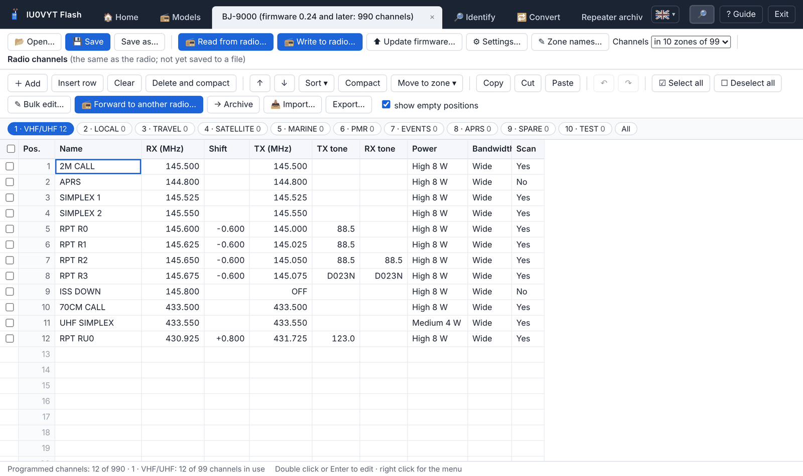
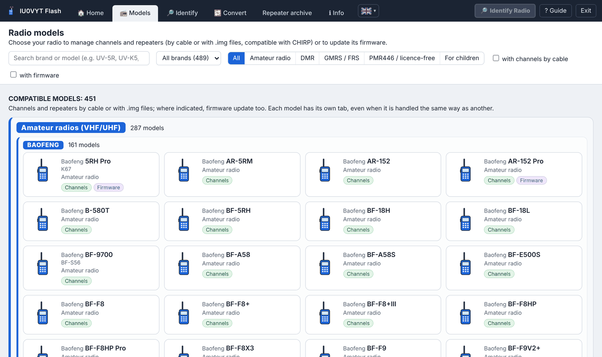

# IU0VYT Flash

<div align="center">
<table>
<tr>
<td align="center"><br><sub><b>English</b></sub></td>
<td align="center"><a href="README.it.md"><br><sub>Italiano</sub></a></td>
<td align="center"><a href="lingue/fr/README.md"><br><sub>Français</sub></a></td>
<td align="center"><a href="lingue/de/README.md"><br><sub>Deutsch</sub></a></td>
<td align="center"><a href="lingue/es/README.md"><br><sub>Español</sub></a></td>
<td align="center"><a href="lingue/pt/README.md"><br><sub>Português</sub></a></td>
<td align="center"><a href="lingue/ru/README.md"><br><sub>Русский</sub></a></td>
<td align="center"><a href="lingue/zh/README.md"><br><sub>中文</sub></a></td>
<td align="center"><a href="lingue/ja/README.md"><br><sub>日本語</sub></a></td>
<td align="center"><a href="lingue/ko/README.md"><br><sub>한국어</sub></a></td>
<td align="center"><a href="lingue/ar/README.md"><br><sub>العربية</sub></a></td>
<td align="center"><a href="lingue/ms/README.md"><br><sub>Bahasa Melayu</sub></a></td>
<td align="center"><a href="lingue/hi/README.md"><br><sub>हिन्दी</sub></a></td>
</tr>
</table>
</div>

<p align="center">
<a href="https://github.com/IU0VYT/IU0VYT/releases/latest"></a>
<a href="https://github.com/IU0VYT/IU0VYT/releases"></a>
<a href="LICENSE"></a>


</p>

**Version 4.18.0** · Windows · interface in 13 languages (italiano, English, Français, Deutsch, Español, Português, Русский, 中文, 日本語, 한국어, العربية, Bahasa Melayu, हिन्दी) · a single executable file, no installation

A program for radio amateurs and users of transceivers of **47 brands** (**Baofeng**, **Bajeton**, **Quansheng**, **Retevis**, **Radtel**, **Radioddity**, **TIDRADIO**, **TYT**, **Hiroyasu**, Talkpod, Anysecu, MaxTalker, Abbree, Intek, Maverick, BTECH, WLN, Zastone, Luiton, TID, Explorer, MMLradio, JJCC, Socotran, Jianpai, Boristone, HamGeek, SenhaiX, Cignus, Puxing, Feidaxin, KYD, KSUN, Lanchonlh, Boblov, Wouxun, AnyTone, QYT, Rugged, Baojie, MTC, Zartek, Ruyage, TDXone, Yaesu, Icom, Kenwood): it reads and writes channels, frequencies and settings via the programming cable, manages an archive of Italian repeaters and updates the firmware of the supported radios.

🌐 Program site: **[iu0vyt.github.io/IU0VYT](https://iu0vyt.github.io/IU0VYT/)**

*Italian original: [README.it.md](README.it.md). The guide and the other information files are translated in the [`lingue`](lingue/) folder.*

<p align="center">


</p>

## Features

- **Channels and frequencies** of 498 models (including digital PMR and DMR radios, also via USB): read and write via cable, CHIRP-compatible `.img` files, original files of the Baofeng K67 Pro (`.xlc`) and the Bajeton 8300 (`.dat`).
- **Radio settings** (menus, display, VOX, squelch, TOT, DTMF, keys…) for 427 models, with a description of every item and a warning to confirm for the sensitive ones.
- **Identification of the connected radio**: the program recognizes it by itself and shows make, model, type, firmware and the other information it reports (for USB DMR radios also DMR ID and name). With **automatic identification** (button in the «Identify» tab, choice remembered) you just connect the cable, whatever tab you are in: the program listens to all the cable ports together, also recognizes a radio turned on after connecting the cable and several radios connected to different cables, tries first the radios already recognized in the past and the most common ones, is not fooled by radios in firmware update mode and opens each one's tab with the channels read; the «Identifying radio» box appears only for the cable with a radio that answers; for another radio there is the **«🔎 Identify radio»** button at the top right.
- **Forwarding to another radio**: the channels ticked in one radio are written directly to another connected radio, chosen by make and model, with compatibility check, adaptation, backup copy and verification.
- **Universal converter**: the channels of any radio or file (K67 `.xlc`, Bajeton `.dat`, `.img` images also from CHIRP, CHIRP CSV, Excel/CSV) in the format of any other radio, adapted to its rules.
- **Interface in 13 languages** with the flag selector next to «ℹ Info»: immediate translation of the whole program (Arabic right to left), language remembered at restart; information files translated in the `lingue` folder.
- **Zone names** instead of «Zone 1», «Zone 2»… (Radtel RT-950 Pro, RT-950, RT-920, RT-910, Bajeton BJ-9000 and BJ-7700, Hiroyasu HI-UV850 Pro; zones of the DMR radios RD-5R, DM-1801 and DM-32UV), read and written by cable together with the channels.
- **Bulk edit** of the ticked channels: power, bandwidth, scan, subtones, shift or transmission together, the rest of each channel stays as it is.
- **Gallery of 552 models** of 47 brands, divided into compatible and non-compatible, by type (amateur, DMR, GMRS/FRS, PMR446, for children) and by brand, with search, filters and links to the official programs and manuals.
- **Repeater archive** based on the updated list by [IK2ANE](https://www.ik2ane.it), with filters and insertion into the radios, with a compatibility check between repeaters and radio before writing.
- **Firmware update** of 57 models (also the Quansheng UV-K5, UV-K6 and UV-5R Plus, the Radtel RT-590 and RT-600 with Quansheng's and Radtel's .bin files, the Radtel RT-470, RT-470L, RT-470X, RT-495 and RT-630 with Radtel's .kdhx files, the TIDRADIO TD-H3, TD-H8 and Radtel RT-730 with the manufacturer's .BIN files, the Retevis RA79 V3 and RA89 with .bin files and the Retevis RT85 with Retevis's .hex files, the Radtel RT-950 Pro and RT-950 and the Bajeton BJ-9000 with .BTF files, the Radtel RT-920 and RT-910B with .anc files, the Radtel RT-910 and RT-900 and the Bajeton BJ-7700 without Bluetooth with .BTU files, the Radtel RT-890 with Radtel's and M7OCM's .bin files, the Baofeng DM-1701 via USB with Baofeng's .bin files, the Baofeng RD-5R and DM-1801 via USB with .sgl files), with file check and backup copy of the radio; guided update with the official program for BTECH DMR-6X2 and DMR-6X2 PRO.
- Automatic **backup copy** before every write and verification afterwards.
- **Check for updates** of the program at every start.

## Use

1. Download [`IU0VYT.Flash.zip`](https://github.com/IU0VYT/IU0VYT/releases/latest/download/IU0VYT.Flash.zip) (latest version) and extract the archive.
2. Start `IU0VYT Flash.exe` (Windows 10/11; it uses the Windows WebView2 component).
3. From the **📻 Models** tab choose your radio, connect the cable and use **Read from radio**.

The complete guide is in [`lingue/en/GUIDE.txt`](lingue/en/GUIDE.txt) (Italian original: [`LEGGIMI.txt`](LEGGIMI.txt)).

## Building

Go 1.22 or later is needed. In the `sorgenti` folder:

```
go build -mod=vendor -trimpath -ldflags "-H=windowsgui -s -w" -o "IU0VYT Flash.exe" .
```

The libraries are included in the `vendor` folder.

## Warnings

- The radio protocols were reconstructed for interoperability and verified with simulated radios: **always keep the backup copies**. The program is provided without any warranty.
- Independent program, **not affiliated with or endorsed** by the radio manufacturers (Baofeng, Bajeton, Quansheng, Retevis, Radtel, Radioddity, TIDRADIO and the others). The trademarks mentioned belong to their respective owners and only serve to indicate the compatible radios.
- Respect the rules on the use of frequencies in your country.

## Acknowledgements

- [CHIRP](https://chirpmyradio.com) and its authors: most of the radio drivers derive from their work.
- [IK2ANE](https://www.ik2ane.it), who makes the list of Italian repeaters available to everyone, free of charge.

Authors and licenses of the components: [`AUTHORS_AND_LICENSES.txt`](lingue/en/AUTHORS_AND_LICENSES.txt).

## License

Copyright © 2026 Daniele "IU0VYT" Bonifazi · [qrz.com/db/IU0VYT](https://www.qrz.com/db/IU0VYT)

Free software distributed under the **GNU General Public License version 3 or later** (`GPL-3.0-or-later`): see [`LICENSE`](LICENSE) and [`LICENSE_NOTICE.txt`](lingue/en/LICENSE_NOTICE.txt).
