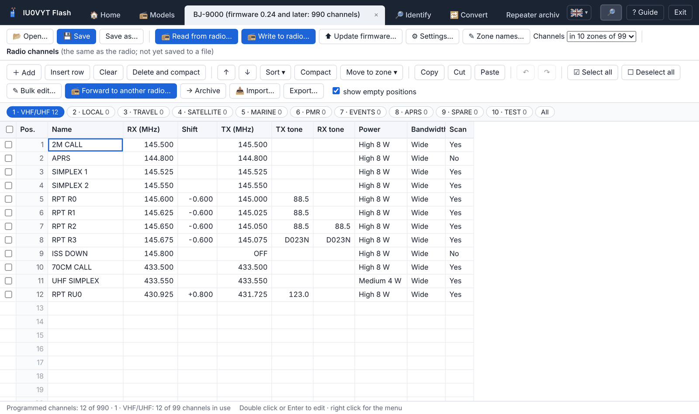
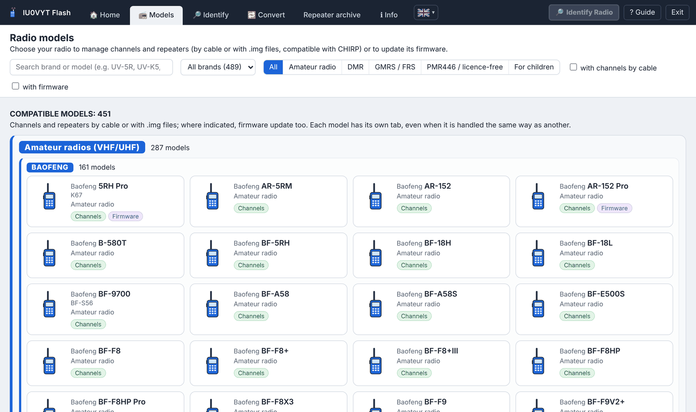

# IU0VYT Flash

<div align="center">
<table>
<tr>
<td align="center"><a href="../../README.md"><br><sub>English</sub></a></td>
<td align="center"><a href="../../README.it.md"><br><sub>Italiano</sub></a></td>
<td align="center"><a href="../../lingue/fr/README.md"><br><sub>Français</sub></a></td>
<td align="center"><a href="../../lingue/de/README.md"><br><sub>Deutsch</sub></a></td>
<td align="center"><a href="../../lingue/es/README.md"><br><sub>Español</sub></a></td>
<td align="center"><a href="../../lingue/pt/README.md"><br><sub>Português</sub></a></td>
<td align="center"><a href="../../lingue/ru/README.md"><br><sub>Русский</sub></a></td>
<td align="center"><a href="../../lingue/zh/README.md"><br><sub>中文</sub></a></td>
<td align="center"><a href="../../lingue/ja/README.md"><br><sub>日本語</sub></a></td>
<td align="center"><a href="../../lingue/ko/README.md"><br><sub>한국어</sub></a></td>
<td align="center"><a href="../../lingue/ar/README.md"><br><sub>العربية</sub></a></td>
<td align="center"><a href="../../lingue/ms/README.md"><br><sub>Bahasa Melayu</sub></a></td>
<td align="center"><br><sub><b>हिन्दी</b></sub></td>
</tr>
</table>
</div>

<p align="center">
<a href="https://github.com/IU0VYT/IU0VYT/releases/latest"></a>
<a href="https://github.com/IU0VYT/IU0VYT/releases"></a>
<a href="../../LICENSE"></a>


</p>

**संस्करण 4.17.0** · Windows · 13 भाषाओं में इंटरफ़ेस (italiano, English, Français, Deutsch, Español, Português, Русский, 中文, 日本語, 한국어, العربية, Bahasa Melayu, हिन्दी) · केवल एक निष्पादन योग्य फ़ाइल, बिना इंस्टॉलेशन

शौक़िया रेडियो ऑपरेटरों और **47 ब्रांडों** (**Baofeng**, **Bajeton**, **Quansheng**, **Retevis**, **Radtel**, **Radioddity**, **TIDRADIO**, **TYT**, **Hiroyasu**, Talkpod, Anysecu, MaxTalker, Abbree, Intek, Maverick, BTECH, WLN, Zastone, Luiton, TID, Explorer, MMLradio, JJCC, Socotran, Jianpai, Boristone, HamGeek, SenhaiX, Cignus, Puxing, Feidaxin, KYD, KSUN, Lanchonlh, Boblov, Wouxun, AnyTone, QYT, Rugged, Baojie, MTC, Zartek, Ruyage, TDXone, Yaesu, Icom, Kenwood) के ट्रांसीवर रेडियो के उपयोगकर्ताओं के लिए प्रोग्राम: यह प्रोग्रामिंग केबल से चैनल, फ़्रीक्वेंसी और सेटिंग्स पढ़ता और लिखता है, इतालवी रिपीटरों का संग्रह संभालता है और समर्थित रेडियो का फ़र्मवेयर अपडेट करता है।

🌐 प्रोग्राम की साइट: **[iu0vyt.github.io/IU0VYT](https://iu0vyt.github.io/IU0VYT/)**

*यह [README.it.md](../../README.it.md) का हिन्दी अनुवाद है; इतालवी मूल पाठ ही संदर्भ पाठ है। मार्गदर्शिका और अन्य जानकारी फ़ाइलें [`lingue`](../../lingue/) फ़ोल्डर में अनूदित हैं।*

<p align="center">


</p>

## सुविधाएँ

- 494 मॉडलों के **चैनल और फ़्रीक्वेंसी** (डिजिटल PMR और DMR रेडियो सहित, USB से भी): केबल से पढ़ना और लिखना, CHIRP-संगत `.img` फ़ाइलें, Baofeng K67 Pro (`.xlc`) और Bajeton 8300 (`.dat`) की मूल फ़ाइलें।
- 425 मॉडलों के लिए **रेडियो की सेटिंग्स** (मेनू, डिस्प्ले, VOX, स्क्वेल्च, TOT, DTMF, बटन…), हर विकल्प के विवरण और संवेदनशील विकल्पों के लिए पुष्टि वाली चेतावनी के साथ।
- **जुड़े हुए रेडियो की पहचान**: प्रोग्राम उसे अपने आप पहचानता है और ब्रांड, मॉडल, प्रकार, फ़र्मवेयर और रेडियो द्वारा बताई गई अन्य जानकारी दिखाता है (USB वाले DMR रेडियो के लिए DMR ID और नाम भी)। **स्वचालित पहचान** («पहचानें» टैब का बटन, चुनाव याद रखा जाता है) के साथ बस केबल जोड़ें, आप किसी भी टैब में हों: प्रोग्राम सभी केबल पोर्ट एक साथ सुनता है, केबल जोड़ने के बाद चालू किए गए रेडियो और अलग-अलग केबलों से जुड़े कई रेडियो भी पहचानता है, पहले वे रेडियो आज़माता है जो पहले पहचाने जा चुके हैं और जो सबसे आम हैं, फ़र्मवेयर अपडेट मोड वाले रेडियो से धोखा नहीं खाता और हर रेडियो का टैब पढ़े गए चैनलों के साथ खोलता है; «रेडियो की पहचान जारी है» बॉक्स केवल उस केबल के लिए दिखता है जिसका रेडियो उत्तर देता है; दूसरे रेडियो के लिए ऊपर दाईं ओर **«🔎 रेडियो पहचानें»** बटन है।
- **दूसरे रेडियो में फ़ॉरवर्ड करें**: एक रेडियो में चिह्नित चैनल सीधे दूसरे जुड़े हुए रेडियो में लिखे जाते हैं, जिसे ब्रांड और मॉडल से चुना जाता है, संगतता जाँच, अनुकूलन, बैकअप और सत्यापन के साथ।
- **सार्वभौमिक कन्वर्टर**: किसी भी रेडियो या फ़ाइल (K67 `.xlc`, Bajeton `.dat`, CHIRP की भी `.img` इमेज, CHIRP CSV, Excel/CSV) के चैनल किसी भी दूसरे रेडियो के फ़ॉर्मेट में, उसके नियमों के अनुसार ढालकर।
- **13 भाषाओं में इंटरफ़ेस**, «ℹ जानकारी» के पास झंडे वाले चयनकर्ता के साथ: पूरे प्रोग्राम का तुरंत अनुवाद (अरबी दाएँ से बाएँ), दोबारा शुरू करने पर भाषा याद रहती है; जानकारी फ़ाइलें `lingue` फ़ोल्डर में अनूदित हैं।
- «ज़ोन 1», «ज़ोन 2»… की जगह **ज़ोन के नाम** (Radtel RT-950 Pro, RT-950, RT-920, RT-910, Bajeton BJ-9000 और BJ-7700, Hiroyasu HI-UV850 Pro; DMR रेडियो RD-5R, DM-1801 और DM-32UV के ज़ोन), जो चैनलों के साथ केबल से पढ़े और लिखे जाते हैं।
- चिह्नित चैनलों का **एक साथ संपादन**: पावर, बैंडविड्थ, स्कैन, सबटोन, शिफ़्ट या ट्रांसमिशन एक साथ, हर चैनल का बाक़ी हिस्सा जैसा है वैसा रहता है।
- 47 ब्रांडों के **548 मॉडलों की गैलरी**, संगत और असंगत में, प्रकार (शौक़िया, DMR, GMRS/FRS, PMR446, बच्चों के लिए) और ब्रांड के अनुसार बँटी हुई, खोज, फ़िल्टर और आधिकारिक प्रोग्रामों व मैनुअल के लिंक के साथ।
- [IK2ANE](https://www.ik2ane.it) की अद्यतन सूची पर आधारित **रिपीटर संग्रह**, फ़िल्टर और रेडियो में डालने की सुविधा के साथ, लिखने से पहले रिपीटर और रेडियो के बीच संगतता जाँच के साथ।
- 57 मॉडलों का **फ़र्मवेयर अपडेट** (Quansheng UV-K5, UV-K6 और UV-5R Plus, Radtel RT-590 और RT-600 भी Quansheng और Radtel की .bin फ़ाइलों से, Radtel RT-470, RT-470L, RT-470X, RT-495 और RT-630 Radtel की .kdhx फ़ाइलों से, TIDRADIO TD-H3, TD-H8 और Radtel RT-730 निर्माता की .BIN फ़ाइलों से, Retevis RA79 V3 और RA89 .bin फ़ाइलों से और Retevis RT85 Retevis की .hex फ़ाइलों से, Radtel RT-950 Pro और RT-950 तथा Bajeton BJ-9000 .BTF फ़ाइलों से, Radtel RT-920 और RT-910B .anc फ़ाइलों से, Radtel RT-910 और RT-900 तथा बिना Bluetooth वाला Bajeton BJ-7700 .BTU फ़ाइलों से, Radtel RT-890 Radtel और M7OCM की .bin फ़ाइलों से, Baofeng DM-1701 USB के ज़रिए Baofeng की .bin फ़ाइलों से, Baofeng RD-5R और DM-1801 USB के ज़रिए .sgl फ़ाइलों से), फ़ाइल की जाँच और रेडियो के बैकअप के साथ; BTECH DMR-6X2 और DMR-6X2 PRO के लिए आधिकारिक प्रोग्राम के साथ निर्देशित अपडेट।
- हर बार लिखने से पहले स्वचालित **बैकअप** और बाद में सत्यापन।
- हर बार शुरू होने पर प्रोग्राम के **अपडेट की जाँच**।

## उपयोग

1. [`IU0VYT.Flash.zip`](https://github.com/IU0VYT/IU0VYT/releases/latest/download/IU0VYT.Flash.zip) (नवीनतम संस्करण) डाउनलोड करें और संग्रह को एक्सट्रैक्ट करें।
2. `IU0VYT Flash.exe` शुरू करें (Windows 10/11; यह Windows के WebView2 घटक का उपयोग करता है)।
3. **📻 मॉडल** टैब से अपना रेडियो चुनें, केबल जोड़ें और **रेडियो से पढ़ें** का उपयोग करें।

पूरी मार्गदर्शिका [`lingue/hi/GUIDE.txt`](../../lingue/hi/GUIDE.txt) में है (इतालवी मूल: [`LEGGIMI.txt`](../../LEGGIMI.txt))।

## बिल्ड करना

Go 1.22 या उसके बाद का संस्करण चाहिए। `sorgenti` फ़ोल्डर में:

```
go build -mod=vendor -trimpath -ldflags "-H=windowsgui -s -w" -o "IU0VYT Flash.exe" .
```

लाइब्रेरी `vendor` फ़ोल्डर में शामिल हैं।

## चेतावनियाँ

- रेडियो के प्रोटोकॉल इंटरऑपरेबिलिटी के लिए पुनर्निर्मित किए गए और सिम्युलेटेड रेडियो से जाँचे गए हैं: **बैकअप हमेशा सँभालकर रखें**। प्रोग्राम बिना किसी वारंटी के दिया जाता है।
- स्वतंत्र प्रोग्राम, रेडियो निर्माताओं (Baofeng, Bajeton, Quansheng, Retevis, Radtel, Radioddity, TIDRADIO और अन्य) से **संबद्ध या उनके द्वारा समर्थित नहीं**। उल्लिखित ट्रेडमार्क उनके अपने स्वामियों के हैं और केवल संगत रेडियो बताने के लिए हैं।
- अपने देश में फ़्रीक्वेंसी के उपयोग के नियमों का पालन करें।

## आभार

- [CHIRP](https://chirpmyradio.com) और उसके लेखक: रेडियो के अधिकांश ड्राइवर उन्हीं के काम से निकले हैं।
- [IK2ANE](https://www.ik2ane.it), जो इतालवी रिपीटरों की सूची सबके लिए निःशुल्क उपलब्ध कराते हैं।

घटकों के लेखक और लाइसेंस: [`AUTHORS_AND_LICENSES.txt`](../../lingue/hi/AUTHORS_AND_LICENSES.txt)।

## लाइसेंस

कॉपीराइट © 2026 Daniele "IU0VYT" Bonifazi · [qrz.com/db/IU0VYT](https://www.qrz.com/db/IU0VYT)

**GNU General Public License संस्करण 3 या उसके बाद के संस्करण** (`GPL-3.0-or-later`) के अंतर्गत वितरित मुक्त सॉफ़्टवेयर: [`LICENSE`](../../LICENSE) और [`LICENSE_NOTICE.txt`](../../lingue/hi/LICENSE_NOTICE.txt) देखें।
