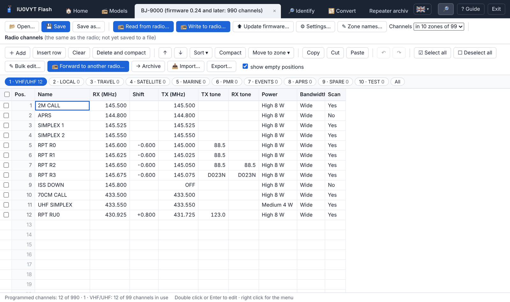
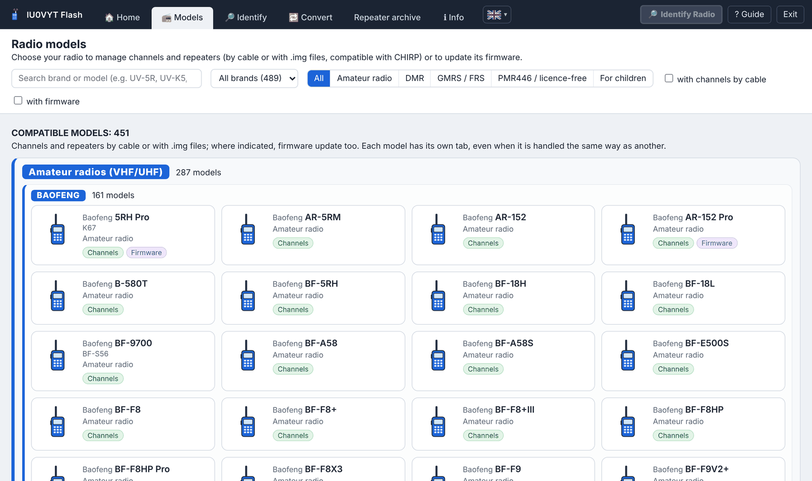

# IU0VYT Flash

<div align="center">
<table>
<tr>
<td align="center"><a href="../../README.md"><br><sub>English</sub></a></td>
<td align="center"><a href="../../README.it.md"><br><sub>Italiano</sub></a></td>
<td align="center"><a href="../../lingue/fr/README.md"><br><sub>Français</sub></a></td>
<td align="center"><a href="../../lingue/de/README.md"><br><sub>Deutsch</sub></a></td>
<td align="center"><a href="../../lingue/es/README.md"><br><sub>Español</sub></a></td>
<td align="center"><a href="../../lingue/pt/README.md"><br><sub>Português</sub></a></td>
<td align="center"><a href="../../lingue/ru/README.md"><br><sub>Русский</sub></a></td>
<td align="center"><a href="../../lingue/zh/README.md"><br><sub>中文</sub></a></td>
<td align="center"><a href="../../lingue/ja/README.md"><br><sub>日本語</sub></a></td>
<td align="center"><a href="../../lingue/ko/README.md"><br><sub>한국어</sub></a></td>
<td align="center"><a href="../../lingue/ar/README.md"><br><sub>العربية</sub></a></td>
<td align="center"><br><sub><b>Bahasa Melayu</b></sub></td>
</tr>
</table>
</div>

<p align="center">
<a href="https://github.com/IU0VYT/IU0VYT/releases/latest"></a>
<a href="https://github.com/IU0VYT/IU0VYT/releases"></a>
<a href="../../LICENSE"></a>


</p>

**Versi 4.12.0** · Windows · antara muka dalam 11 bahasa (italiano, English, Français, Deutsch, Español, Português, Русский, 中文, 日本語, 한국어, العربية) · satu fail boleh laku sahaja, tanpa pemasangan

Program untuk amatur radio dan pengguna transceiver **44 jenama** (**Baofeng**, **Bajeton**, **Quansheng**, **Retevis**, **Radtel**, **Radioddity**, **TIDRADIO**, **TYT**, **Hiroyasu**, Talkpod, Anysecu, MaxTalker, Abbree, Intek, Maverick, BTECH, WLN, Zastone, Luiton, TID, Explorer, MMLradio, JJCC, Socotran, Jianpai, Boristone, HamGeek, SenhaiX, Cignus, Puxing, Feidaxin, KYD, KSUN, Lanchonlh, Boblov, Wouxun, AnyTone, QYT, Rugged, Baojie, MTC, Zartek, Ruyage, TDXone): ia membaca dan menulis saluran, frekuensi dan tetapan melalui kabel pengaturcaraan, menguruskan arkib pengulang (repeater) Itali dan mengemas kini firmware radio yang disokong.

🌐 Laman program: **[iu0vyt.github.io/IU0VYT](https://iu0vyt.github.io/IU0VYT/)**

*Teks asal Itali: [README.it.md](../../README.it.md). Panduan dan fail maklumat lain diterjemahkan dalam folder [`lingue`](../../lingue/).*

<p align="center">


</p>

## Ciri-ciri

- **Saluran dan frekuensi** untuk 451 model (termasuk radio PMR digital dan DMR, juga melalui USB): baca dan tulis melalui kabel, fail `.img` yang serasi dengan CHIRP, fail asal Baofeng K67 Pro (`.xlc`) dan Bajeton 8300 (`.dat`).
- **Tetapan radio** (menu, paparan, VOX, squelch, TOT, DTMF, kekunci…) untuk 396 model, dengan penerangan bagi setiap item dan amaran pengesahan untuk item yang sensitif.
- **Pengenalan radio yang disambung**: program mengenalinya secara automatik dan memaparkan jenama, model, jenis, firmware dan maklumat lain yang dilaporkannya (untuk radio DMR USB juga ID DMR dan nama). Dengan **pengenalan automatik** (butang dalam tab «Identify», pilihan diingati) anda hanya perlu menyambungkan kabel, dalam mana-mana tab sekalipun: program memantau semua port kabel serentak, turut mengecam radio yang dihidupkan selepas kabel disambung serta beberapa radio yang disambung pada kabel berbeza, mencuba dahulu radio yang pernah dikenalinya dan yang paling biasa, tidak terpedaya dengan radio dalam mod kemas kini firmware, dan membuka tab setiap radio dengan saluran yang dibaca; kotak «Identifying radio» hanya muncul untuk kabel dengan radio yang menjawab; untuk radio lain terdapat butang **«🔎 Identify radio»** di bahagian atas kanan.
- **Pemajuan ke radio lain**: saluran yang ditanda dalam satu radio ditulis terus ke radio lain yang disambung, dipilih mengikut jenama dan model, dengan semakan keserasian, penyesuaian, salinan sandaran dan pengesahan.
- **Penukar sejagat**: saluran daripada mana-mana radio atau fail (K67 `.xlc`, Bajeton `.dat`, imej `.img` termasuk daripada CHIRP, CSV CHIRP, Excel/CSV) ke format mana-mana radio lain, disesuaikan dengan peraturannya.
- **Antara muka dalam 11 bahasa** dengan pemilih bendera di sebelah «ℹ Info»: terjemahan serta-merta seluruh program (bahasa Arab dari kanan ke kiri), bahasa diingati pada mula semula; fail maklumat diterjemahkan dalam folder `lingue`.
- **Nama zon** sebagai ganti «Zone 1», «Zone 2»… (Radtel RT-950 Pro, RT-950, RT-920, RT-910, Bajeton BJ-9000 dan BJ-7700, Hiroyasu HI-UV850 Pro; zon untuk radio DMR RD-5R, DM-1801 dan DM-32UV), dibaca dan ditulis melalui kabel bersama-sama saluran.
- **Suntingan pukal** saluran yang ditanda: kuasa, lebar jalur, imbasan, subton, anjakan atau pancaran serentak, selebihnya setiap saluran kekal seperti sediakala.
- **Galeri 489 model** daripada 44 jenama, dibahagikan kepada serasi dan tidak serasi, mengikut jenis (amatur, DMR, GMRS/FRS, PMR446, untuk kanak-kanak) dan mengikut jenama, dengan carian, penapis dan pautan ke program serta manual rasmi.
- **Arkib pengulang** berdasarkan senarai terkini oleh [IK2ANE](https://www.ik2ane.it), dengan penapis dan pemasukan ke dalam radio, berserta semakan keserasian antara pengulang dan radio sebelum ditulis.
- **Kemas kini firmware** untuk 57 model (termasuk Quansheng UV-K5, UV-K6 dan UV-5R Plus, Radtel RT-590 dan RT-600 dengan fail .bin Quansheng dan Radtel, Radtel RT-470, RT-470L, RT-470X, RT-495 dan RT-630 dengan fail .kdhx Radtel, TIDRADIO TD-H3, TD-H8 dan Radtel RT-730 dengan fail .BIN pengilang, Retevis RA79 V3 dan RA89 dengan fail .bin serta Retevis RT85 dengan fail .hex Retevis, Radtel RT-950 Pro dan RT-950 serta Bajeton BJ-9000 dengan fail .BTF, Radtel RT-920 dan RT-910B dengan fail .anc, Radtel RT-910 dan RT-900 serta Bajeton BJ-7700 tanpa Bluetooth dengan fail .BTU, Radtel RT-890 dengan fail .bin Radtel dan M7OCM, Baofeng DM-1701 melalui USB dengan fail .bin Baofeng, Baofeng RD-5R dan DM-1801 melalui USB dengan fail .sgl), dengan semakan fail dan salinan sandaran radio; kemas kini berpandu dengan program rasmi untuk BTECH DMR-6X2 dan DMR-6X2 PRO.
- **Salinan sandaran** automatik sebelum setiap penulisan dan pengesahan selepasnya.
- **Semakan kemas kini** program pada setiap permulaan.

## Penggunaan

1. Muat turun [`IU0VYT.Flash.zip`](https://github.com/IU0VYT/IU0VYT/releases/latest/download/IU0VYT.Flash.zip) (versi terkini) dan ekstrak arkib.
2. Jalankan `IU0VYT Flash.exe` (Windows 10/11; ia menggunakan komponen Windows WebView2).
3. Daripada tab **📻 Models** pilih radio anda, sambungkan kabel dan gunakan **Read from radio**.

Panduan lengkap ada dalam [`lingue/en/GUIDE.txt`](../../lingue/en/GUIDE.txt) (teks asal Itali: [`LEGGIMI.txt`](../../LEGGIMI.txt)).

## Pembinaan

Go 1.22 atau lebih baharu diperlukan. Dalam folder `sorgenti`:

```
go build -mod=vendor -trimpath -ldflags "-H=windowsgui -s -w" -o "IU0VYT Flash.exe" .
```

Pustaka disertakan dalam folder `vendor`.

## Amaran

- Protokol radio dibina semula untuk kesalingbolehan (interoperability) dan disahkan dengan radio simulasi: **sentiasa simpan salinan sandaran**. Program diberikan tanpa sebarang jaminan.
- Program bebas, **tidak bergabung atau disokong** oleh pengilang radio (Baofeng, Bajeton, Quansheng, Retevis, Radtel, Radioddity, TIDRADIO dan lain-lain). Tanda dagangan yang disebut adalah milik pemilik masing-masing dan hanya bertujuan menunjukkan radio yang serasi.
- Patuhi peraturan penggunaan frekuensi di negara anda.

## Penghargaan

- [CHIRP](https://chirpmyradio.com) dan para pengarangnya: kebanyakan pemacu radio diperoleh daripada kerja mereka.
- [IK2ANE](https://www.ik2ane.it), yang menyediakan senarai pengulang Itali kepada semua, secara percuma.

Pengarang dan lesen komponen: [`AUTHORS_AND_LICENSES.txt`](../../lingue/en/AUTHORS_AND_LICENSES.txt).

## Lesen

Hak cipta © 2026 Daniele "IU0VYT" Bonifazi · [qrz.com/db/IU0VYT](https://www.qrz.com/db/IU0VYT)

Perisian bebas yang diedarkan di bawah **GNU General Public License versi 3 atau kemudian** (`GPL-3.0-or-later`): lihat [`LICENSE`](../../LICENSE) dan [`LICENSE_NOTICE.txt`](../../lingue/en/LICENSE_NOTICE.txt).
